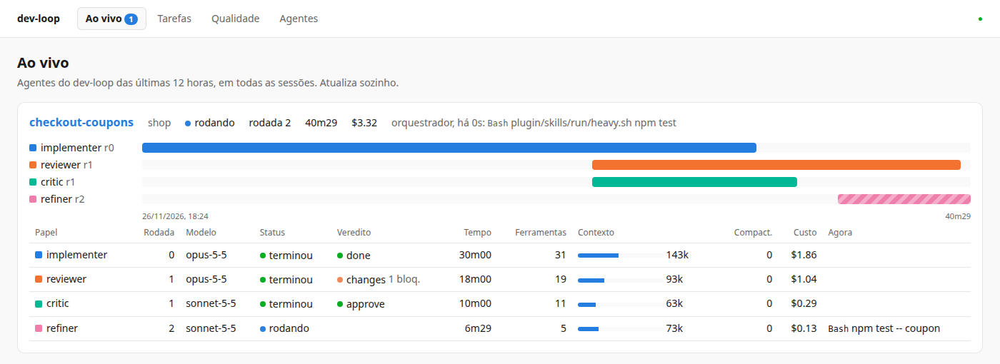
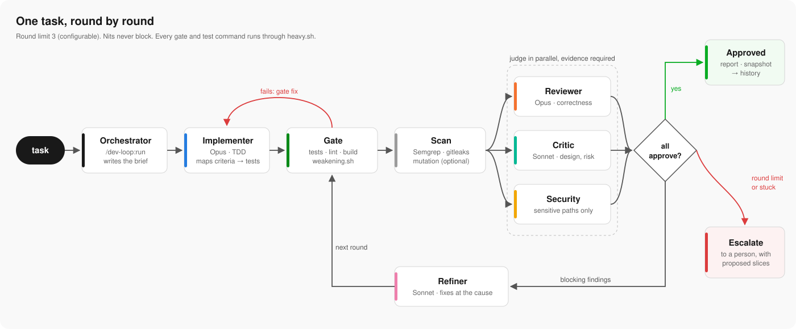
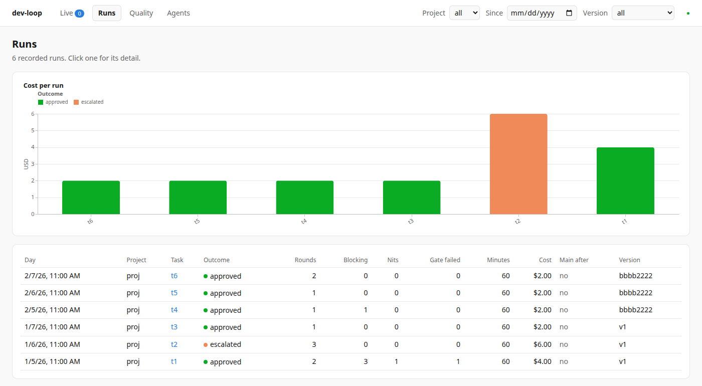
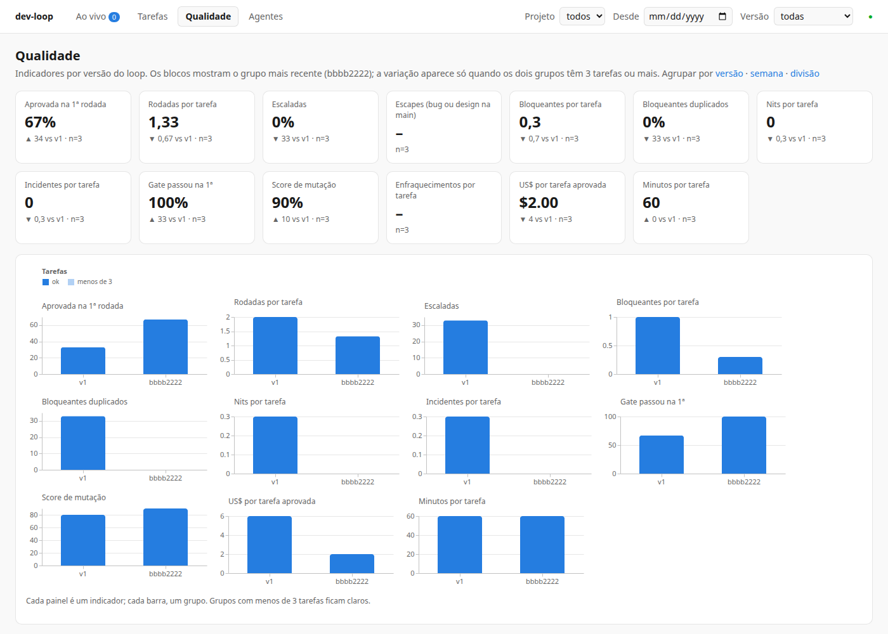
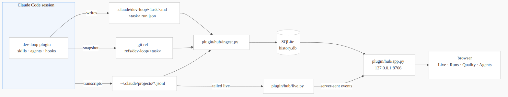

# dev-loop

A development loop of agents for [Claude Code](https://claude.com/claude-code): one agent implements a task with
TDD, a gate runs the tests, a reviewer and a critic judge the diff in parallel, and a second implementer fixes what
they block, until both approve or the loop hands the task back to a person. Every run is recorded, and a local web
UI shows the agents live, the history and whether a change to the loop made it better.



## How it works



| Role | Agent | Model | Job |
| --- | --- | --- | --- |
| Orchestrator | skill `/dev-loop:run`, the main session | the session's | Writes the brief, dispatches, runs the gate, decides. Writes no production code. |
| Implementer | `dev-loop:implementer` | Opus | First version with TDD; runs the gate itself and maps each criterion to its test. |
| Reviewer | `dev-loop:reviewer` | Opus | Correctness: criteria, bugs, callers, project rules, test gaps. |
| Critic | `dev-loop:critic` | Sonnet | Adversarial: needless code, what breaks it, fit with the codebase, long-term cost. |
| Security | the project's `securityReviewer` | its own | Only on sensitive paths. |
| Refiner | `dev-loop:refiner` | Sonnet | Second implementer on another model: fixes blocking findings at their cause, or rejects them with a checkable reason. |

What keeps it honest:

- **Evidence or it is a nit.** A blocking finding needs a command and its output, a failing test or quoted lines.
- **No weakening.** `weakening.sh` fails the gate on skipped or deleted tests, removed assertions, new lint or type
  suppressions and edited check configs.
- **Static scan and mutation testing.** `scan.sh` runs Semgrep and gitleaks locally on the changed files; optional
  Stryker survivors on changed lines go to the reviewer as test gaps.
- **A round limit.** After 3 rounds (configurable), or when the judges are stuck, it escalates to a person and
  proposes vertical slices to run separately.
- **A safe machine.** Every heavy command runs through `heavy.sh`: a time limit everywhere and, on Linux, one at a
  time, only with free memory, under a systemd memory cap.

## Requirements

- Claude Code with plugin support
- Bash and Python 3 on the PATH as `python3` (standard library only). Linux, macOS and Windows (Claude Code runs
  its commands in Git Bash there) all work; see [Machine resources](#machine-resources) for what each one gets.
- Optional: [Semgrep](https://semgrep.dev) and [gitleaks](https://github.com/gitleaks/gitleaks) for the scan,
  [Stryker](https://stryker-mutator.io) for mutation testing, [Datasette](https://datasette.io) for ad-hoc SQL

## Install

```bash
claude plugin marketplace add edsonsousa/dev-loop
claude plugin install dev-loop@dev-loop
pipx install semgrep            # optional static scan; gitleaks: a release binary on your PATH
```

The UI ships inside the plugin, in `hub/`. Run it from a clone, or from the installed plugin's folder (its path is
in `~/.claude/plugins/`):

```bash
git clone https://github.com/edsonsousa/dev-loop.git && cd dev-loop
plugin/hub/serve.sh             # http://127.0.0.1:8766; on Windows: python plugin/hub/app.py
```

To work on the plugin itself, add the clone as the marketplace instead (`claude plugin marketplace add ./dev-loop`)
and run `/reload-plugins` in a session after each edit.

For mutation testing of TypeScript (optional), Stryker lives outside the projects; pin `typescript`, `vite` and
`vitest` to the project's versions:

```bash
mkdir -p ~/.local/share/dev-loop/stryker && cd ~/.local/share/dev-loop/stryker
echo '{"name":"dev-loop-mutation","private":true}' > package.json
npm install --legacy-peer-deps @stryker-mutator/core @stryker-mutator/vitest-runner typescript@5 vite vitest
```

## Commands

- `/dev-loop:run <task>`: runs the loop on one task.
- `/dev-loop:retro`: reads the history and proposes changes to the agents and settings.
- `/dev-loop-view`: a live pane of the loop's agents beside the chat, and a status line with round, running agents
  and cost.

## Use in a project

1. Add `.claude/dev-loop.yml` (or run `/dev-loop:run` once and let it write one from the project's CLAUDE.md):

```yaml
roundLimit: 3
mainBranch: main
gate:
  - when: src/
    run: npm test
sensitive:
  - src/auth/
securityReviewer: security-reviewer   # an agent type; omit to skip
securityFocus: auth, tenant isolation, secrets   # optional; default: authentication, authorization,
                                                 # untrusted input and secrets
mutation:                             # optional; survivors on changed lines go to the reviewer
  - when: src/lib/
    run: ~/.local/share/dev-loop/stryker/node_modules/.bin/stryker run --testRunner vitest --reporters clear-text --mutate {files}
onApproval: Set the task's status in TODO.md.
resources:                            # optional, for heavy.sh; defaults shown
  minFreeGb: 4                        # wait until this much memory is free
  maxGb: 18                           # memory cap per command (default 60% of RAM)
  waitMinutes: 8                      # then give up with exit 75
  timeoutMinutes: 20                  # a command running longer is killed: exit 124, a gate failure
weakeningTests: '\.it\.lua$'            # optional regexes, added to weakening.sh's own patterns
weakeningSuppressions: 'luacheck: ignore'
watch:                                # optional; the watchdog stops an agent past one of these
  stallMinutes: 30                    # no transcript change
  repeat: 5                           # the same tool call in a row
  maxToolCalls: 150
  maxCompactions: 2
  maxUsd: 5
```

Gate and mutation lines for common stacks. Every line runs through `heavy.sh`; put the lint and type checks in the
gate too, so the loop cannot leave them red:

| Stack | `gate` | `mutation` (optional) |
| --- | --- | --- |
| TypeScript / JS | `npm test -- --maxWorkers=2`, `npx tsc --noEmit`, `npx eslint .` | Stryker, as above (tested) |
| Frontend E2E | `npx playwright test --workers=2` | |
| Java | `mvn -q verify` or `./gradlew check` | PIT (`pitest-maven`), whole module |
| Kotlin | `./gradlew check` | PIT with the Kotlin plugin, whole module |
| Python | `pytest -q`, `ruff check .`, `mypy .` | mutmut, configured in `pyproject.toml` |
| Go | `go test ./...`, `go vet ./...` | |
| Rust | `cargo test`, `cargo clippy -- -D warnings` | cargo-mutants |
| C# | `dotnet test` | Stryker.NET (`dotnet stryker`) |

Only the Stryker line replaces `{files}` with the changed files; the others mutate the whole module, which is slower.
`weakening.sh` knows the test files and the skip and suppression markers of all these stacks, plus Ruby, PHP and
Swift; add your own with `weakeningTests` and `weakeningSuppressions`.

2. Keep the loop's logs out of git: `.claude/dev-loop/` in `.gitignore` (or `.claude/*` with
   `!.claude/dev-loop.yml`).
3. The project should have a CLAUDE.md with its rules: every agent reads it.

Per task the loop writes `.claude/dev-loop/<task>.md` (readable log), `<task>.run.json` (the record the history
loads) and a git ref `refs/dev-loop/<task>` with the code as the loop left it, so the history can compare it with
what reached main. Remove those refs with `git for-each-ref --format='%(refname)' refs/dev-loop | xargs -n1 git update-ref -d`.

### Machine resources

Every gate, mutation and test command, the orchestrator's and the agents', runs through
`plugin/skills/run/heavy.sh`, so parallel agents and sessions cannot freeze the machine. What it can enforce depends
on the platform:

| | Time limit (`timeoutMinutes`) | One at a time | Waits for free memory | Memory cap |
| --- | --- | --- | --- | --- |
| Linux with systemd | yes | yes (`flock`) | yes (`/proc`) | yes (user scope) |
| Linux without systemd | yes | yes | yes | no |
| macOS | with `gtimeout` (`brew install coreutils`) | no | no | no |
| Windows (Git Bash) | yes | no | no | no |

`DEV_LOOP_NO_LIMITS=1` turns everything but the time limit off on any platform. Where the queue and the cap are
missing, cap the tools' own parallelism in the gate lines, for example `--maxWorkers=2` for Vitest and
`--concurrency 2` for Stryker.

## UI

One page, four tabs; every run and agent links to its detail.

- **Live** (above): every dev-loop task of the last 12 hours in any session. For each task, the
  orchestrator's last action, a timeline of its agents, and per agent: status, verdict, time, tool calls, context
  against 300k, cost, and the tool it is running now. It updates by itself (server-sent events).
- **Runs**: the recorded runs, with filters by project, date and loop version. Each run's detail has a
  timeline, cost per role, gates, blocking findings with evidence, nits, agents, and what changed on main afterwards.

  

- **Quality**: indicators per loop version or per week: first-round approval, rounds, escalations,
  escapes, blocking and duplicates, nits, gate first pass, mutation score, weakening, cost per approved run,
  minutes. Deltas show only between groups of 3 runs or more. Name a version there to mark an experiment.

  

- **Agents**: peak context, minutes and cost of every agent.

The screenshots use example data (`python3 plugin/hub/test_app.py --serve 8798`).



```bash
plugin/hub/serve.sh              # the UI on http://127.0.0.1:8766 (PORT=... to change); keeps the history up to date
plugin/hub/serve.sh sql          # the database in Datasette on :8767, for ad-hoc SQL (pipx install datasette)
python3 plugin/hub/ingest.py     # ingest only; /dev-loop:run does this at the end of every task
python3 plugin/hub/test_app.py --serve 8798   # the UI on fixture data: two loop versions, three runs each
```

The loop version is a hash of the plugin's agents, skills and scripts (`plugin/skills/run/version.sh`), so a
change to any of them starts a new version by itself; runs recorded before it are `baseline`.
The server listens on 127.0.0.1 only, answers only to that host name, and shows tool names and paths from the
transcripts, never their content. Its one write is a version's name.

Claude Code deletes transcripts after `cleanupPeriodDays` (30 by default); the agent rows already ingested stay in
the database. Costs are estimates from the `price` table in `schema.sql`; edit it there or in the database.

## Development

```bash
python3 plugin/hub/test_ingest.py && python3 plugin/hub/test_app.py
plugin/skills/run/test_weakening.sh && plugin/skills/run/test_heavy.sh
```

Layout:

- `plugin/`: the Claude Code plugin: `skills/run` (the orchestrator and its scripts), `skills/retro`, `agents/`
  (implementer, reviewer, critic, refiner, each compacting at 300k tokens), `hooks/` (the live pane) and `hub/`
- `plugin/hub/`: `ingest.py` loads run records, agent transcripts and git into `~/.local/share/dev-loop/history.db`;
  `app.py` serves the UI; `live.py` reads the transcripts as they grow; `watch.py` is the watchdog;
  `schema.sql`, `views.sql`, `static/`
- `docs/img/`: the images of this README. `loop.svg` is edited by hand; `architecture.png` is rendered from
  `architecture.mmd` with `mmdc -i architecture.mmd -o architecture.png -s 2 -b "#f9f9f9"`

## License

[MIT](LICENSE). `plugin/hub/static/vendor/` holds Vega 6.4, Vega-Lite 6.5 and Vega-Embed 7.4 under BSD-3-Clause, so the UI
works offline.
